# igz_solids — parametric solids for IngeTrazo

`igz_solids` is a toolbar extension for
**[IngeTrazo](https://github.com/ingelibre/ingetrazo)** that creates
parametric 3D solids: box, capsule, cylinder/tube, sphere, cone/pyramid,
geodesic sphere (including a football), helix, prism and torus.

It is a port of a set of SketchUp Ruby tools (the *ArkZ* solid tools) to
IngeTrazo's Python plugin API.

Every solid is built as a **closed (watertight) mesh**, inserted as its **own
Group**, and committed as **one undo step**.

- **Author:** Ezequiel M. Rezende
- **Date:** 2026-10-10
- **Version:** 1.0.0
- **License:** [GPL-3.0-or-later](https://www.gnu.org/licenses/gpl-3.0.html)
  (same as IngeTrazo — see [LICENSE](https://github.com/ingelibre/ingetrazo/blob/main/LICENSE))

  ---

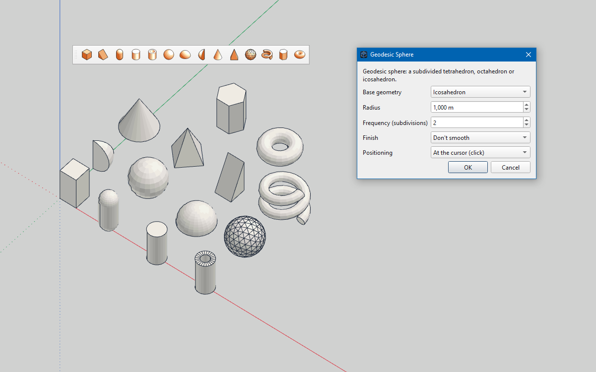

*The **Solids** toolbar, the Geodesic Sphere dialog and some solids built with them.*

---

## Features

- **14 toolbar buttons** (see the table below), mirrored in
  **Extensions ▸ Solids**.
- **Parameter dialog** per solid; measurements in metres.
- **Two placement modes** — *At the cursor (click)*: a live wireframe follows
  the mouse and each click drops a solid; or *At the origin (0, 0, 0)*.
- **Groups** — every solid lands as a Group, named after the button and
  selected on creation. Because it has its own mesh it never welds to the
  model, so it stays easy to select, move and edit. While you are editing a
  group or component, the new solid is created inside it.
- **Watertight and correctly wound** — the mesh is oriented outward and the
  curved seams are softened (soft edges) while flat lids and annuli keep
  crisp rims: the IngeTrazo equivalent of SketchUp's *soft + smooth*.
- **Internationalised** — English (source), Spanish, Brazilian Portuguese and
  Italian; it follows IngeTrazo's UI language.
- **Themed SVG icons** for the dark and the light interface.
- **No extra dependencies** — it uses only IngeTrazo (PySide6 comes with it).

## Requirements

- **IngeTrazo** (0.x — extension API version 2).
- Windows or Linux (any platform IngeTrazo runs on).
- No `pip install` needed.

## Installation

The easy way: in IngeTrazo open **Extensions ▸ Open plugins folder**, drop the
`igz_solids` folder there and **restart IngeTrazo**. The **Solids** toolbar and
the **Extensions ▸ Solids** submenu appear at startup.

Manually, copy the folder into your per-user plugins directory:

- **Windows:** `%APPDATA%\IngeTrazo\plugins\igz_solids`
- **Linux:** `~/.local/share/ingetrazo/plugins/igz_solids`
  (or `$XDG_DATA_HOME/ingetrazo/plugins/igz_solids`)

## Usage

1. Click a button on the **Solids** toolbar (or **Extensions ▸ Solids**).
2. Fill in the dialog and press **OK**.
3. Choose **Positioning**:
   - **At the cursor (click):** move the mouse — the solid is previewed as a
     wireframe — and click to drop it. The tool stays active so you can place
     several; press **Esc** to stop.
   - **At the origin (0, 0, 0):** the solid is created at the world origin.
4. The new solid arrives as a **Group**, already selected, in one undo step.

> Measurements are in **metres** (IngeTrazo's internal unit).

## The solids

| Toolbar button | Icon | Shape | Dialog options |
|---|---|---|---|
| **Box** | 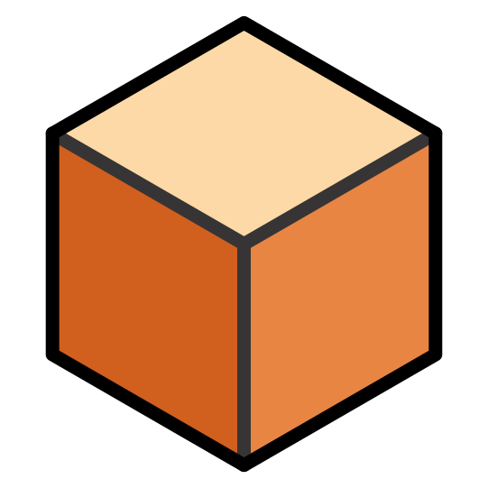 | Rectangular box | Width (X), Length (Y), Height (Z) |
| **Wedge** | 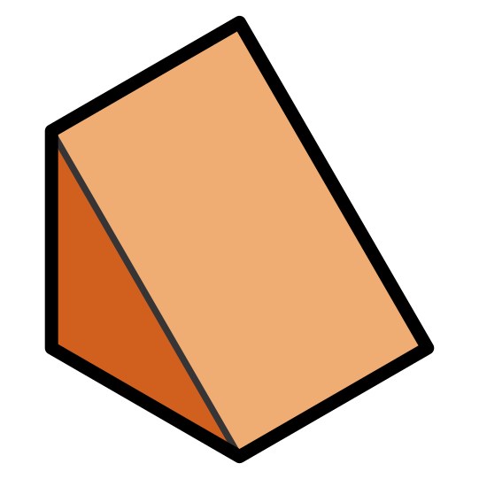 | Right-triangular wedge (prism) | Width (X), Length (Y), Height (Z) |
| **Capsule** | 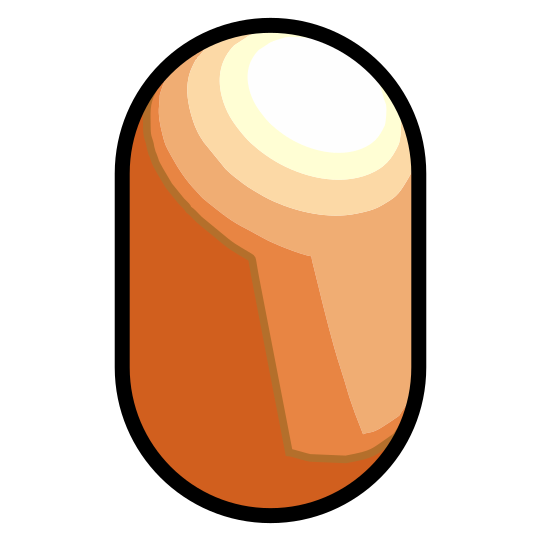 | Cylinder with two hemispherical caps | Radius, Body height, Horizontal segments, Segments per cap |
| **Cylinder** | 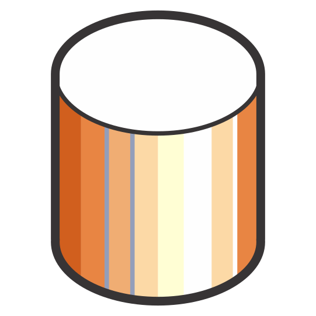 | Circular cylinder | Outer radius, Segments, Height |
| **Tube** | 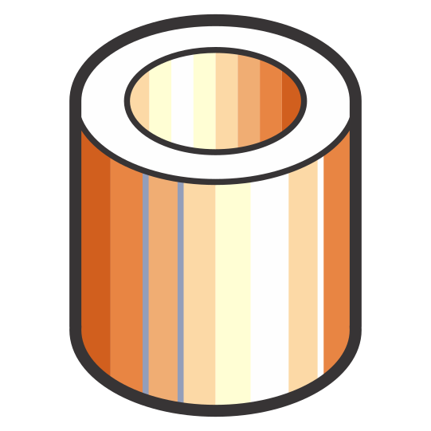 | Hollow circular tube | Outer radius, Inner radius, Segments, Height |
| **Sphere** | 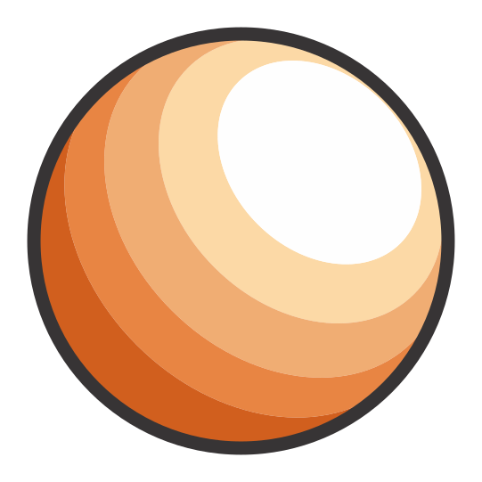 | Full UV sphere | Radius, Horizontal segments, Vertical segments |
| **Domus** | 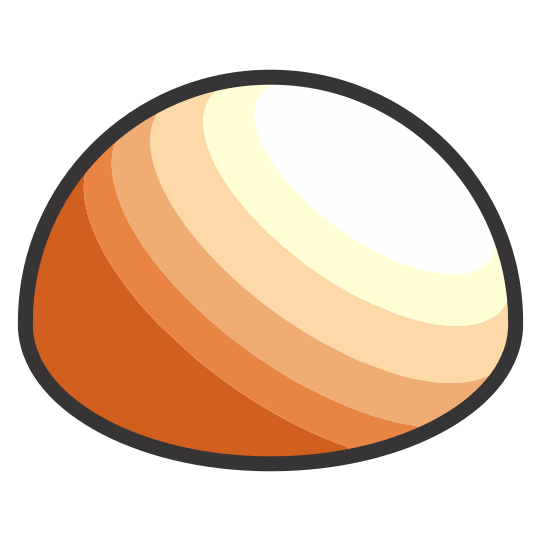 | Hemisphere with a flat base | Radius, Horizontal / Vertical segments |
| **Wedge** (sphere) | 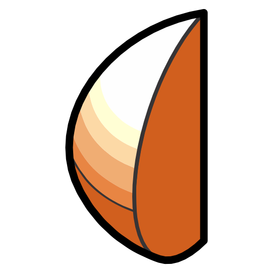 | Spherical wedge (segment) | Radius, Horizontal / Vertical segments, Wedge angle |
| **Cone** | 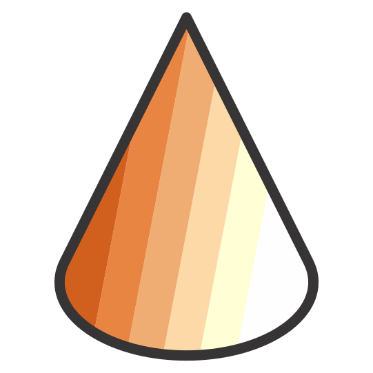 | Cone (smooth, ≥ 12 sides) | Base radius, Top radius (0 = apex), Height, Sides |
| **Pyramid** | 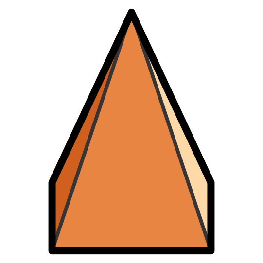 | Faceted pyramid | Base radius, Top radius (0 = trunc), Height, Sides |
| **Geodesic Sphere** | 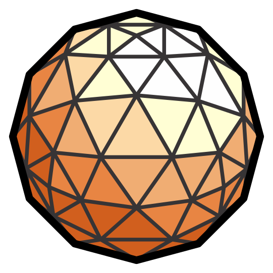 | Geodesic sphere (see below) | Base geometry, Radius, Frequency, Finish |
| **Helix** | 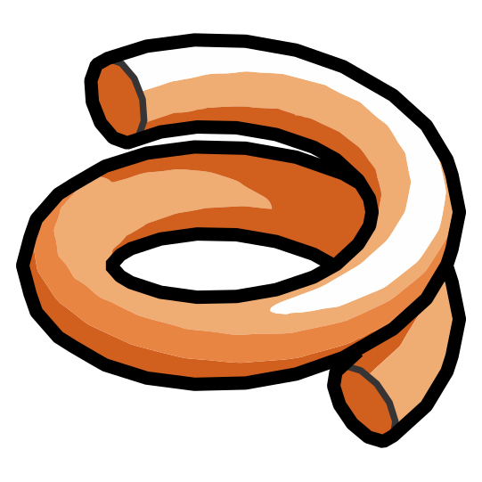 | Solid helix (tubular spring) | Helix radius, Tube radius, Total height, Turns, Segments per turn, Tube segments |
| **Prism** | 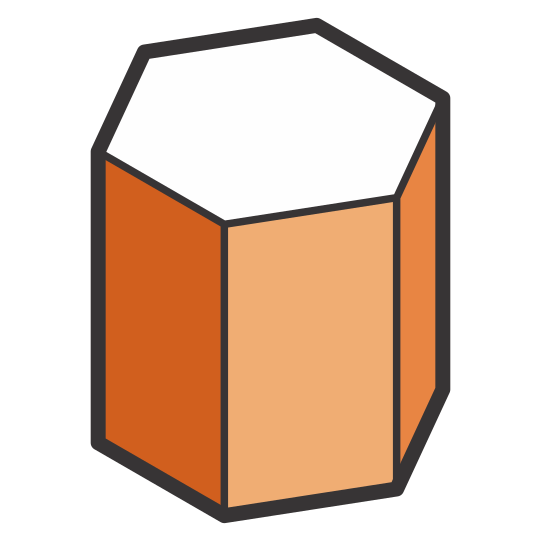 | Regular N-sided prism (≥ 12 sides reads round) | Base radius, Height, Sides |
| **Torus** | 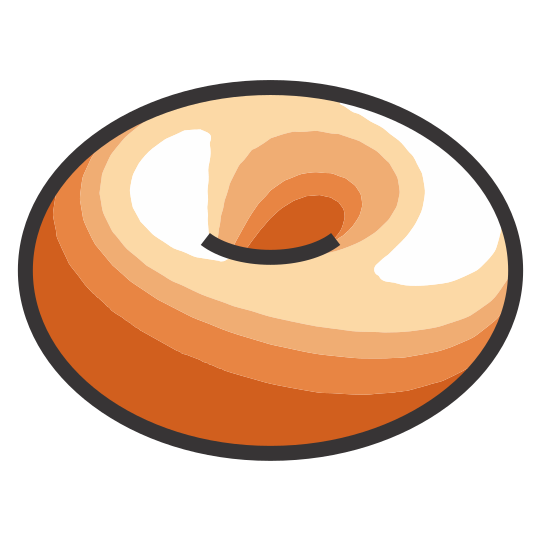 | Ring torus | Major radius (ring), Minor radius (section), Ring segments, Section segments |

The **Box/Wedge**, **Cylinder/Tube**, **Sphere/Domus/Wedge**, **Cone/Pyramid**
buttons share a *Type* pulldown, so every variant is also reachable from the
dialog.

### Geodesic sphere

The **Geodesic Sphere** dialog offers four base geometries:

- **Tetrahedron**, **Octahedron**, **Icosahedron** — subdivided *Frequency*
  times (0–4) and projected onto the sphere.
- **Football (soccer ball)** — the exact **truncated icosahedron**: 12
  pentagons + 20 hexagons (60 vertices, 90 edges, 32 faces, V − E + F = 2).
  The *Frequency* field does not apply to it.

*Finish* chooses **Don't smooth** (crisp facet/panel edges — the classic
football look) or **Smooth** (soft seams).

## Files

Once installed, the extension lives in a single folder:

```
<plugins>/
└── igz_solids/
    ├── __init__.py        # extension entry point (exposes setup(app))
    ├── _core.py           # private engine: dialog, placement tool, group insert, i18n, icons
    ├── tb_list.txt        # the toolbar buttons, in order
    ├── tb_box.py          # one module per family of solids (SPEC + build)
    ├── tb_capsule.py
    ├── tb_cylinder.py
    ├── tb_sphere.py
    ├── tb_frustrum.py
    ├── tb_geodesic.py
    ├── tb_helix.py
    ├── tb_prism.py
    ├── tb_torus.py
    ├── i18n/              # en.json (source), es.json, pt-BR.json, it.json
    ├── icons/             # themed SVGs: tb_<name>.svg and tb_<name>_light.svg
    ├── README.md          # this file
    ├── README_ptBR.md     # Portuguese version
    ├── LICENSE            # GNU GPL v3.0
    └── THIRD-PARTY.md     # third-party notices
```

In the source repository the package is assembled from `packaging/igz_solids/`
(the code) plus `icons/` and the two READMEs at the root, and released as
`dist/igz_solids.zip` — see [`PUBLISHING.md`](PUBLISHING.md).

`_core.py` is underscore-prefixed **on purpose**: IngeTrazo's loader
instantiates every `Tool` subclass *defined in the plugin module*
(`__init__.py`) with no arguments, so the interactive `Tool` must live in a
submodule the loader skips.

## Adding your own solid

Each `tb_*.py` exposes two things:

- `SPEC` — the dialog metadata (name, icon, tooltip, fields) plus the toolbar
  entries in `ACTIONS`, so one module can feed several buttons.
- `build(params, origin)` — the pure geometry, returning
  `(faces, cap_indices, smooth)`, where `faces` is a list of vertex loops
  (`QVector3D`, metres), `cap_indices` indexes the flat faces whose rims stay
  sharp, and `smooth` asks for softened seams.

To add one: create `tb_mysolid.py`, add its module name on a line of
`tb_list.txt`, and restart IngeTrazo.

Choice fields use `{"value": <stable token>, "label": <English source>}` so a
label can be translated without changing what `build()` compares.

## Internationalisation

English is the **source** language: the strings passed to `tr()` are English.
The extension ships flat `{english: translation}` catalogs in `i18n/`, and
`tr()` resolves in this order: **plugin catalog → IngeTrazo catalog → English**.
The active language is IngeTrazo's (`core.i18n.current_language()`); since
IngeTrazo applies a language change on restart, the toolbar relabels itself on
the next launch.

To add a language, copy `i18n/it.json` to `i18n/<code>.json` (use the code
IngeTrazo uses, e.g. `id`, `zh-CN`) and translate the values.

## Icons

Each toolbar action looks up `icons/<name>.svg`. According to the window
palette, `load_icon()` prefers `icons/<name>_light.svg`, falling back to the
other file when the chosen one is missing. The convention is controlled by the
`LIGHT_ICONS_FOR_DARK_THEME` constant in `_core.py`.

## Credits

- **IngeTrazo** — the host application and its plugin API.
- The original **SketchUp Ruby tools** (the *ArkZ* parametric-solid tools)
  that this extension ports to IngeTrazo.

## License

**GPL-3.0-or-later.** See [`LICENSE`](LICENSE) (the GNU GPL v3.0 text) and
[`THIRD-PARTY.md`](THIRD-PARTY.md) for third-party notices.


